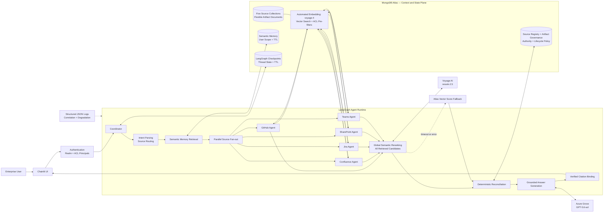

# AI Context Platform Architecture

## Solution diagram

## High-level architecture

1. **Experience and security:** Chainlit provides the user experience. Authentication
   resolves a tenant realm, user identity, and document access principals.
2. **Agent orchestration:** LangGraph coordinates intent parsing, memory retrieval,
   parallel source searches, reranking, reconciliation, generation, and persistence.
3. **Source-aware retrieval:** Thin agents represent GitHub, Confluence, Jira,
   SharePoint, and Teams. Atlas applies realm and ACL filters before vector ranking.
4. **Global reranking:** Voyage `rerank-2.5` compares every retrieved candidate directly
   with the rewritten query. Results remain aligned to their original Atlas documents.
5. **Deterministic reasoning:** Configurable semantic relevance, authority, and freshness
   weights rank evidence and expose normalized claim contradictions. Artifact-level policy
   authority and lifecycle status can refine source defaults. Voyage relevance is the semantic
   component when available; Atlas vector similarity is the fallback.
6. **Grounded generation:** Azure Grove writes the response after reconciliation.
   Model-supplied citation URLs are removed; binding accepts only artifacts present in the
   retrieved evidence set. Production buffers draft tokens until this verification completes.
7. **State and operations:** MongoDB stores artifacts, source policy, semantic memory,
   and LangGraph checkpoints. Chainlit sessions share one process-level MongoDB client and
   graph runtime. TTL and unique memory indexes enforce lifecycle and identity, while structured
   logs expose correlation identifiers and degraded capabilities.

## Retrieval and ranking sequence

1. Atlas Automated Embedding uses `voyage-4` to maintain document vectors.
2. Each source agent executes Atlas Vector Search with `realm_id` and
   `access_principals` pre-filters, then scans a bounded window for one permission-scoped
   representative of each of up to three alternate claim values.
3. Voyage `rerank-2.5` globally scores every retrieved candidate; `top_k=None` preserves
   all evidence needed for contradiction analysis.
4. The truth score combines 55% semantic relevance, 30% source authority, and 15%
   freshness by default. These weights are validated and configurable.
5. Deterministic claim comparison selects preferred evidence before Grove writes prose.
   Each decision records one representative per value, its timestamp and lifecycle status,
   and the score margin over the best competing value.

## Key technical decisions

- **Thin source agents:** Connectors retrieve evidence but do not independently decide truth.
- **Parallel retrieval:** Independent source searches run concurrently to reduce latency.
- **Global semantic reranking:** Voyage compares every candidate directly with the user query;
  Atlas vector similarity remains available as a resilient fallback.
- **No reranker data loss:** Every returned index and score is validated, and incomplete or
  malformed responses trigger fallback instead of silently dropping evidence.
- **Central reconciliation:** All sources receive consistent authority and freshness rules.
- **Governed evidence classes:** Policy, implementation, runbook, and historical incident
  records carry explicit lifecycle status and optional authority overrides.
- **Deterministic scoring:** Conflict resolution remains explainable, configurable, and testable.
- **LLM after retrieval:** Grove generates grounded prose but does not establish authority.
- **Verified citations:** References are bound to actual retrieved documents.
- **Convergent index bootstrap:** Existing autoEmbed definitions are normalized and compared;
  compatible drift updates in place, while incompatible index types fail explicitly.
- **Defense-in-depth authorization:** Tenant and ACL constraints execute inside Atlas retrieval.
- **Graceful degradation:** Failed sources are reported without creating an ungrounded answer.
- **Replaceable connectors:** APIs or MCP servers can replace synthetic source adapters while
  preserving the normalized artifact contract.

## Why MongoDB is a strong fit

### Unified context and state platform

MongoDB supports enterprise artifacts, vector retrieval, metadata filtering, source policy,
semantic memory, LangGraph checkpoints, and TTL retention in one operational platform. This
avoids maintaining separate document, vector, and agent-state databases.

### Flexible enterprise document model

GitHub, Jira, Teams, Confluence, and SharePoint have different metadata. MongoDB preserves
source-specific fields while sharing a common envelope for artifact identity, content,
timestamps, claims, ACLs, and cross-references. Connectors can evolve without repeated rigid
schema migrations.

### Retrieval with authorization

Atlas Vector Search combines semantic retrieval with `realm_id` and `access_principals`
pre-filters. Unauthorized documents are excluded before ranking rather than filtered later
in application code, making retrieval part of the authorization boundary.

Reranking occurs only after this boundary, so Voyage receives candidates the authenticated
request is already authorized to retrieve. Reranker results cannot introduce new documents.

### Automated embedding lifecycle

Atlas Automated Embedding uses Voyage `voyage-4` to create and maintain vectors from
document content. The application stores business documents without coordinating a separate
embedding pipeline and vector synchronization process. New and updated documents become
searchable through the same managed index lifecycle.

### Voyage AI retrieval quality

Voyage models complement MongoDB's operational and governance capabilities:

- **Retrieval-specialized embeddings:** `voyage-4` represents semantic meaning rather than
  relying on exact keyword overlap, improving recall across differently worded enterprise
  questions and artifacts.
- **High-precision reranking:** `rerank-2.5` jointly evaluates the rewritten query and each
  candidate document. This cross-encoder stage provides a more precise relevance signal than
  vector distance alone.
- **Long-context evidence handling:** The reranker supports a 32K-token context window, which
  is useful for detailed architecture, policy, implementation, and compliance artifacts.
- **Instruction-aware and multilingual relevance:** The model can follow retrieval intent and
  compare evidence across multilingual enterprise content without source-specific rankers.
- **Balanced latency and quality:** Atlas Vector Search performs fast, ACL-aware candidate
  generation; Voyage reranks only that bounded candidate set for higher precision.
- **Resilient operation:** The original Atlas vector score is retained, so retrieval continues
  deterministically if the external reranker times out or becomes unavailable.

Together, MongoDB and Voyage provide a two-stage retrieval design: Atlas supplies scalable,
authorized recall, while Voyage improves semantic precision before governed reconciliation.

### Stateful-agent support

MongoDB durably stores LangGraph checkpoints and user-scoped semantic memory beside source
evidence. TTL indexes, tombstones, deduplication, and bounded retention provide lifecycle
controls without introducing another persistence system. A unique partial `memory_id` index
protects deterministic upserts from concurrent duplication.

### Explainable reconciliation

The source registry and normalized claims support authority, freshness decay, contradiction
detection, and calibrated truth scores. Policies remain queryable and auditable instead of
being hidden in prompts.

Contradiction decisions retain all supporting artifact IDs for audit, but send one scored
representative per competing value to the writer. This guarantees that stale evidence is
grounded without flooding the prompt or Sources appendix with repetitive documents.

Voyage improves query-to-document semantic ordering without replacing these deterministic
governance controls. Both the original Atlas vector score and Voyage rerank score remain
visible in the evidence inspector for auditability.

## Validation status

- Live Voyage `rerank-2.5` API contract test passes.
- The end-to-end Atlas → Voyage → reconciliation → Grove flow reranked 26 candidates across
  all five source collections without capability degradation.
- The PHI policy case selects the effective SharePoint policy over a historical Teams incident
  suggestion, grounds both representatives, and produces four verified source entries.
- Generic `[source:artifact_id]` output is deterministically rebound to the verified artifact's
  actual source. Model-supplied markdown URLs are removed before rebinding.
- All **4/4 live RAG evaluation cases pass**, including canonical winner, representative,
  stale-evidence, terminology, citation-precision, source-concision, and latency checks.
- All **4/4 assurance retrieval cases pass** for key rotation, dead-letter replay, cache
  invalidation, and break-glass logging.
- A 15-operation, five-worker Atlas retrieval smoke completed with zero errors and no content
  logging; this is a bounded smoke, not a production capacity benchmark.
- The default test profile reports **81 passed and four credential-gated live tests skipped**;
  Ruff, mypy, dependency validation, and IDE diagnostics pass.
- Atlas vector-score fallback is covered by deterministic failure-path tests.

## Conclusion

MongoDB is not universally the best database for every AI system. It is particularly well
suited here because the solution needs flexible enterprise content, semantic retrieval,
strict metadata authorization, durable agent state, and retention controls in one platform.