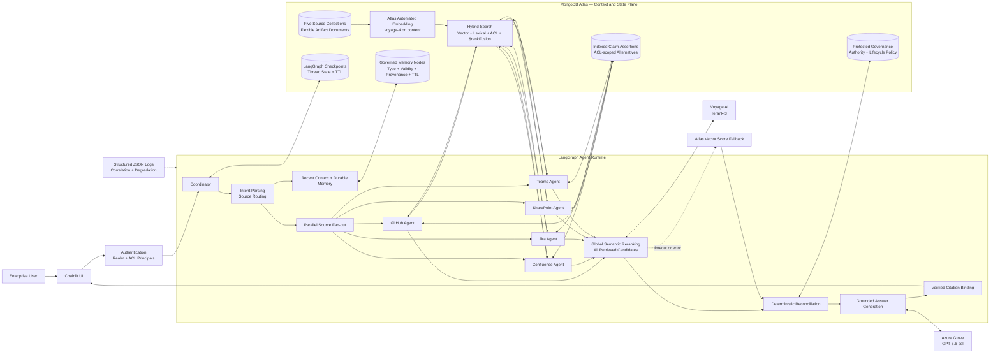

# AI Context Platform Architecture

## Solution diagram

The Chainlit UI exposes a pre-rendered visual version of this diagram through the explicit
**Architecture** header link and the README/welcome preview. It is not opened automatically as a
chat side tab.

## High-level architecture

1. **Experience and security:** Chainlit provides the user experience. Production requires an
   allowed OAuth provider and validated realm/group claims; missing identity scope fails closed.
2. **Agent orchestration:** After identity and intent validation, LangGraph retrieves bounded
   recent turns, governed durable memory, and all selected sources in the same parallel superstep.
3. **Source-aware retrieval:** Thin agents represent GitHub, Confluence, Jira,
   SharePoint, and Teams. Atlas Automated Embedding keeps `voyage-4` vectors current for
   the `content` field, while lexical Atlas Search indexes preserve exact terms, IDs, and
   titles. Atlas applies realm and ACL filters before either retrieval path returns results.
4. **Hybrid fusion:** MongoDB `$rankFusion` combines the semantic and lexical rankings. This
   demonstrates why hybrid search is useful: vector retrieval catches paraphrased concepts,
   while lexical retrieval catches exact policy names, identifiers, and compliance terms.
5. **Global reranking:** Voyage `rerank-3` compares every authorized candidate directly
   with the rewritten query. Results remain aligned to their original Atlas documents, and the
   reranker cannot introduce unauthorized evidence.
6. **Deterministic reasoning:** Configurable relevance, authority, and freshness weights rank
   evidence. Runtime truth metadata comes only from protected governance records; indexed claim
   assertions provide ACL-scoped contradiction representatives.
7. **Grounded generation:** Azure Grove writes the response after reconciliation.
   Model-supplied citation URLs are removed; binding accepts only artifacts present in the
   retrieved evidence set. Production buffers draft tokens until this verification completes.
8. **State and operations:** LangGraph checkpoints retain execution state and recent turns;
   governed memory nodes retain only selected cross-session continuity. Older turns are compacted,
   while TTL and unique indexes enforce lifecycle and identity. Structured logs and `/ready`
   expose content-free memory outcomes, context volume, versions, and degraded capabilities.

## Retrieval and ranking sequence

1. Atlas Automated Embedding uses `voyage-4` to maintain vectors for the `content` path inside
   Atlas Search indexes. The application documents do not contain visible `embedding` arrays,
   so connectors and seed profiles can focus on business content instead of embedding plumbing.
   Explicit lexical indexes cover titles, content, and artifact identifiers.
2. Each source executes ACL-filtered semantic and lexical pipelines. MongoDB `$rankFusion`
   combines them, and indexed claim records supply up to three alternate-value representatives.
3. Voyage `rerank-3` globally scores every retrieved candidate; `top_k=None` preserves
   all evidence needed for contradiction analysis.
4. The truth score combines 55% semantic relevance, 30% source authority, and 15%
   freshness by default. These weights are validated and configurable.
5. Deterministic claim comparison selects preferred evidence before Grove writes prose.
   Each decision records one representative per value, its timestamp and lifecycle status,
   and the score margin over the best competing value.

## Key technical decisions

- **Thin source agents:** Connectors retrieve evidence but do not independently decide truth.
- **Parallel retrieval:** Independent source searches run concurrently to reduce latency.
- **Managed embeddings:** Atlas Automated Embedding owns vector creation and synchronization for
  source content, reducing reusable-demo setup to documents, indexes, and source metadata.
- **Explainable hybrid search:** `$rankFusion` keeps semantic and lexical scoring separate, then
  combines rankings so exact terms and paraphrased concepts can both influence candidate recall.
- **Comparison modes:** `SOURCE_RETRIEVAL_MODE` can temporarily run `vector` or `lexical` only,
  making the value of the default `hybrid` path visible in customer demos.
- **Global semantic reranking:** Voyage compares every candidate directly with the user query;
  Atlas vector similarity remains available as a resilient fallback.
- **No reranker data loss:** Every returned index and score is validated, and incomplete or
  malformed responses trigger fallback instead of silently dropping evidence.
- **Central reconciliation:** All sources receive consistent authority and freshness rules.
- **Governed evidence classes:** Policy, implementation, runbook, and historical incident
  records carry explicit lifecycle status and optional authority overrides.
- **Deterministic scoring:** Conflict resolution remains explainable, configurable, and testable.
- **LLM after retrieval:** Grove generates grounded prose but does not establish authority.
- **Verified citations:** References are bound to actual retrieved documents.
- **Trusted governance boundary:** Connector-owned metadata cannot elevate reconciliation
  authority; protected policy records are overlaid before scoring.
- **Schema enforcement:** Ten application collections use MongoDB JSON Schema validators;
  production defaults to `strict`/`error`.
- **Convergent index bootstrap:** Existing autoEmbed definitions are normalized and compared;
  compatible drift updates in place, while incompatible index types fail explicitly.
- **Defense-in-depth authorization:** Tenant and ACL constraints execute inside Atlas retrieval.
- **Graceful degradation:** Failed sources are reported without creating an ungrounded answer.
- **Replaceable connectors:** APIs or MCP servers can replace synthetic source adapters while
  preserving the normalized artifact contract.
- **Reusable demo profiles:** New domains can reuse the same retrieval, governance, memory, and
  citation pipeline by swapping source seed data, authority rules, claim types, prompts, and evals.

## Reusable demo pattern

The implementation is intentionally structured as a repeatable pattern rather than a one-off
healthcare scenario. A new customer or industry profile can reuse the same runtime by changing:

- **Source profile:** collection names, connector adapters, source labels, and source metadata.
- **Authority profile:** source authority weights, lifecycle rules, freshness half-lives, and
  governance overrides.
- **Claim profile:** the normalized claim keys that should be checked for contradictions.
- **Prompt profile:** customer-relevant starter questions and talk tracks.
- **Evaluation profile:** canonical winner, required terminology, citation, freshness, and latency
  checks for the target use case.

This keeps the core architecture stable while making the content, policy hierarchy, and narrative
portable across domains such as healthcare, financial services, insurance, developer support,
manufacturing quality, legal/compliance, or internal IT operations.

## Why MongoDB is a strong fit

### Unified context and state platform

MongoDB supports enterprise artifacts, vector retrieval, metadata filtering, source policy,
semantic memory, LangGraph checkpoints, and TTL retention in one operational platform. This
avoids maintaining separate document, vector, and agent-state databases.

### Flexible enterprise document model

GitHub, Jira, Teams, Confluence, and SharePoint have different metadata. MongoDB preserves
source-specific fields while sharing a common envelope for artifact identity, content,
timestamps, claims, ACLs, and cross-references. Connectors can evolve without repeated rigid
schema migrations.

### Retrieval with authorization

Atlas Search and Vector Search both apply `realm_id` and `access_principals` filters.
Unauthorized documents are excluded before rank fusion rather than filtered later
in application code, making retrieval part of the authorization boundary.

Reranking occurs only after this boundary, so Voyage receives candidates the authenticated
request is already authorized to retrieve. Reranker results cannot introduce new documents.

### Automated embedding lifecycle

Atlas Automated Embedding uses Voyage `voyage-4` to create and maintain vectors from
document content. The application stores business documents without coordinating a separate
embedding pipeline and vector synchronization process. New and updated documents become
searchable through the same managed index lifecycle.

The generated vectors are part of the managed Atlas Vector Search index definitions, not normal
MongoDB document fields. Inspect the Atlas Search index definitions rather than source documents
to verify embedding usage:

- `content_vector_acl` on `github`, `confluence`, `jira`, `sharepoint`, and `teams`
- `memory_vector_retained` on `memories`

All of these embed the `content` field using `voyage-4`. Source collections also have
`content_lexical` search indexes for exact-term retrieval before `$rankFusion`.

### Voyage AI retrieval quality

Voyage models complement MongoDB's operational and governance capabilities:

- **Retrieval-specialized embeddings:** `voyage-4` represents semantic meaning rather than
  relying on exact keyword overlap, improving recall across differently worded enterprise
  questions and artifacts.
- **High-precision reranking:** `rerank-3` jointly evaluates the rewritten query and each
  candidate document. This cross-encoder stage provides a more precise relevance signal than
  vector distance alone.
- **Long-context evidence handling:** The reranker supports a 32K-token context window, which
  is useful for detailed architecture, policy, implementation, and compliance artifacts.
- **Instruction-aware and multilingual relevance:** The model can follow retrieval intent and
  compare evidence across multilingual enterprise content without source-specific rankers.
- **Balanced latency and quality:** Atlas Vector Search performs fast, ACL-aware candidate
  generation; Voyage reranks only that bounded candidate set for higher precision.
- **Resilient operation:** The original Atlas vector score is retained, so retrieval continues
  deterministically if the external reranker times out or becomes unavailable.

Together, MongoDB and Voyage provide a two-stage retrieval design: Atlas supplies scalable,
authorized recall, while Voyage improves semantic precision before governed reconciliation.

### Stateful-agent support

MongoDB durably stores LangGraph checkpoints separately from user-scoped memory nodes. A
deterministic policy accepts only explicit preferences, decisions, and task context; enterprise
answers remain source evidence rather than learned truth. Memory nodes carry type, importance,
validity, immutable creation provenance, reinforcement revision, embedding profile, prompt/agent
versions, tombstone, and TTL metadata. Exact duplicates reinforce atomically, high-similarity
nodes merge without changing identity content, and deleted identities cannot be resurrected.

Recent raw turns are bounded in the prompt. Older checkpoint messages are deterministically
compacted into a capped summary and removed from active message state after clean handoff. The
context pack normalizes roles to `user`/`assistant`, excludes tool and system payloads, removes the
current query from prior context, preserves citation labels, reserves budget for the compacted
summary, and avoids splitting a user/assistant turn across the compaction boundary.

### Explainable reconciliation

The source registry, protected governance records, and indexed claim assertions support
authority, freshness decay, contradiction detection, and calibrated truth scores. Policies
remain queryable and auditable instead of being hidden in prompts.

Contradiction decisions retain all supporting artifact IDs for audit, but send one scored
representative per competing value to the writer. This guarantees that stale evidence is
grounded without flooding the prompt or Sources appendix with repetitive documents.

Voyage improves query-to-document semantic ordering without replacing these deterministic
governance controls. Both the original Atlas vector score and Voyage rerank score remain
visible in the evidence inspector for auditability.

## Validation status

- Live Voyage `rerank-3` API contract test passes.
- The end-to-end Atlas → Voyage → reconciliation → Grove flow reranked 26 candidates across
  all five source collections without capability degradation.
- The PHI policy case selects the effective SharePoint policy over a historical Teams incident
  suggestion, grounds both representatives, and produces four verified source entries.
- Generic `[source:artifact_id]` output is deterministically rebound to the verified artifact's
  actual source. Model-supplied markdown URLs are removed before rebinding.
- The live RAG evaluation harness remains part of the release gate. The latest post-reseed
  follow-up tracks two metric-gate regressions: one latency-budget miss and one required-term
  coverage miss; retrieval, citations, and degradation checks remained healthy.
- All **4/4 assurance retrieval cases pass** for key rotation, dead-letter replay, cache
  invalidation, and break-glass logging.
- A 15-operation, five-worker Atlas retrieval smoke completed with zero errors and no content
  logging; this is a bounded smoke, not a production capacity benchmark.
- The default test profile reports **114 passed and four credential-gated live tests skipped**;
  Ruff, mypy, dependency validation, and IDE diagnostics pass.
- Atlas vector-score fallback is covered by deterministic failure-path tests.

## Conclusion

MongoDB is not universally the best database for every AI system. It is particularly well
suited here because the solution needs flexible enterprise content, semantic retrieval,
strict metadata authorization, durable agent state, and retention controls in one platform.