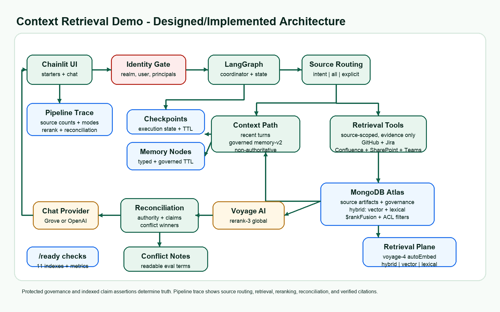

# From Enterprise Search to Governed Answers

Customer-facing presentation for the Context Retrieval Demo.

---

## 1. Title

# From Enterprise Search to Governed Answers

**Source-aware RAG with MongoDB Atlas, hybrid retrieval, reranking, and governed memory**

Presenter: _[Your Name]_

---

## 2. The enterprise knowledge problem

Enterprise knowledge is fragmented across many tools:

- GitHub, Confluence, Jira, SharePoint, Teams, and other systems.
- Search returns documents, not governed answers.
- Different systems often disagree or contain stale guidance.
- Users need answers that respect permissions and include evidence.

**Key message:** enterprise AI needs retrieval, governance, and auditability.

---

## 3. What this demo shows

The demo shows a governed RAG pattern that can:

- Search across multiple enterprise source systems.
- Call source-scoped retrieval tools, not answer-generating subagents.
- Enforce tenant and access-control filters before generation.
- Combine semantic and keyword retrieval.
- Rerank evidence with Voyage `rerank-3`.
- Resolve stale or conflicting claims.
- Generate cited, inspectable answers.
- Maintain selective memory for durable user preferences and task context.

---

## 4. Demo architecture

The assistant coordinates thin retrieval tools, reranking, reconciliation, generation, citations, and
memory through a deterministic LangGraph workflow backed by MongoDB Atlas. The tools return evidence
only; they do not write competing answers.

---

## 5. MongoDB Atlas as the retrieval and memory layer

MongoDB Atlas is used for more than document storage:

- Source collections for enterprise artifacts.
- Atlas Vector Search for semantic retrieval.
- Atlas Search for lexical and exact-match retrieval.
- `$rankFusion` to combine semantic and lexical rankings.
- Protected governance records for source truth.
- Claim assertions for contradiction handling.
- Checkpoints and durable memory.

---

## 6. Why hybrid retrieval matters

Hybrid search is valuable because enterprise questions usually contain both meaning and exact
language.

Semantic search helps with natural-language questions and paraphrases.

Lexical search helps with exact terms such as:

- policy names
- artifact IDs
- system names
- compliance phrases
- ticket references

The demo combines both using MongoDB `$rankFusion` so the system can find conceptually relevant and exact-match evidence.

**Simple explanation:** semantic search finds what the user means; lexical search finds the exact words; hybrid search combines both.

Demo option: run the same prompt in `vector`, `lexical`, and `hybrid` modes to show why the combined path is stronger than either path alone. For architecture comparisons, switch source routing between `intent`, `all`, and `explicit_only`.

---

## 7. Automated Embedding with Atlas

Atlas Automated Embedding keeps document vectors current for the indexed `content` field.

Customer benefits:

- No separate embedding pipeline in the application.
- No visible embedding arrays in source documents.
- Cleaner connector and seed-data model.
- Easier reuse across new demo domains.
- Vector search stays close to the governed data and metadata filters.

---

## 8. Reranking with Voyage `rerank-3`

After Atlas retrieves authorized candidates:

- Voyage `rerank-3` compares the user query directly against each candidate.
- The most relevant evidence is promoted before answer generation.
- Atlas vector similarity remains the fallback if reranking is unavailable.
- Deterministic governance still decides which evidence is trusted.

**Key message:** reranking improves relevance; governance preserves trust.

---

## 9. Governed answers, not just relevant answers

The system evaluates evidence using:

- semantic relevance
- source authority
- freshness
- protected governance metadata
- contradiction representatives
- current versus historical claim status

This helps the assistant prefer the current approved policy over older or lower-authority references.

---

## 10. Permission-aware by design

The demo applies enterprise security boundaries before generation:

- User identity and principals flow into retrieval.
- Tenant and ACL filters are applied inside Atlas queries.
- Unauthorized content is excluded from candidate evidence.
- Citations only point to retrieved, authorized documents.
- Production settings are designed to fail closed.

---

## 11. Governed memory-v2

The assistant only writes durable memory for appropriate content:

- explicit user preferences
- durable decisions
- task context
- valid user-specific facts

It rejects memory writes for normal enterprise Q&A, degraded responses, or low-confidence content.

**Key message:** memory is governed state, not a transcript dump.

---

## 12. Suggested live demo flow

1. Ask a broad enterprise policy question.
2. Show retrieval from all five source tools.
3. Ask a targeted 2-source or 3-source question.
4. Ask a question with conflicting evidence.
5. Show contradiction handling and preferred evidence.
6. Open the evidence inspector to show citations, scores, and conflicts.

---

## 13. Reusable customer demo pattern

The same architecture can be reused for other scenarios by changing the profile:

- source labels and connectors
- seed data and document types
- authority hierarchy
- contradiction claims
- starter prompts
- evaluation cases
- customer talk track

Example target domains: healthcare, finance, insurance, developer support, manufacturing quality, compliance, and internal IT operations.

---

## 14. Business value

This pattern helps organizations:

- Reduce time spent searching across disconnected systems.
- Improve answer trust with citations and evidence inspection.
- Respect existing permissions.
- Handle stale or conflicting information.
- Build reusable enterprise AI architecture.
- Move from chatbot demos to production-ready RAG design.

---

## 15. Validation snapshot

Current demo state:

- 800 synthetic enterprise artifacts across five source systems.
- 11 Atlas Search and Vector Search indexes recreated and ready.
- Schema, retrieval, integration, and UI smoke checks completed.
- Source routing can be compared across `intent`, `all`, and `explicit_only` modes.
- The rendered architecture diagram has been refreshed to show the current routing model.
- Chainlit demo can be restarted locally when needed; it is not assumed to be always running.

Live RAG and assurance retrieval gates are tracked separately from infrastructure health; the latest validated state has both passing at **4/4**.

---

## 16. Closing message

The value is not just faster answers.

The value is faster, permission-aware, cited, and governable answers that business users can trust.
